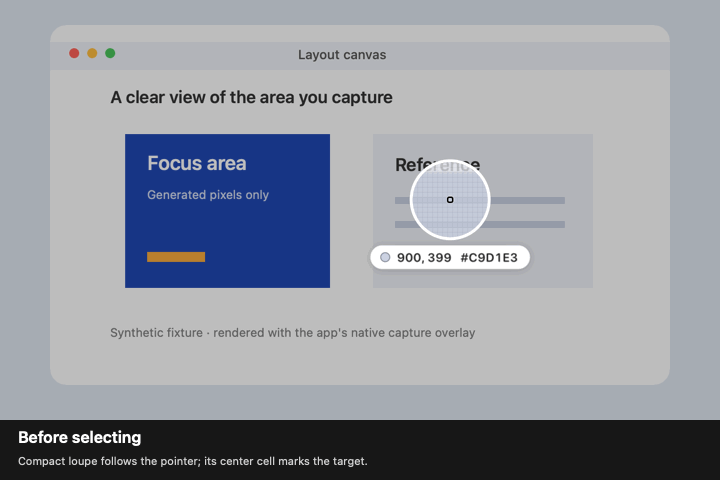

# Capture picker

Before selecting a screenshot or annotation area, the magnifier is centered on the pointer. Its middle cell marks the physical pixel that the color reading samples; moving near a display edge clips the lens instead of moving that target. The color reading stays on screen.

The first area press immediately hides the magnifier, color reading, and separate crosshair on every display. They stay hidden during the drag and subsequent pointer moves, tiny clicks, and area/window switches until a new capture session begins. Selection borders, size readings, and keyboard adjustments continue to work.

Settings → Capture → Magnifier size remembers Small (75 pt, the default), Medium (90 pt), or Large (120 pt) for the next capture. Each shows the same 15 × 15 captured pixels. Standard area capture, annotation, All-In-One, and Self-Timer use the chosen size.

The enlarged image is 75% opaque, while the target border and reading stay opaque. Reduce Transparency restores the opaque preview. The border chooses white or black using the sampled pixel's existing sRGB contrast calculation and keeps an opposite-color outline. Appearance changes do not override that choice. Sampling and copied colors use the original captured pixels.

Pick Color keeps its offset 120 pt lens and crosshair, with the adaptive target border. Recording and scrolling selectors keep their existing offset lens and accent border.

The demonstration renders the actual overlay over generated pixels; it contains no screen capture or personal data. Unit coverage includes 1×/2× geometry, display edges, cross-display suppression, late frames, reused sessions and sizes, persisted settings, saturated colors, appearance refresh, and exact sampled colors.
