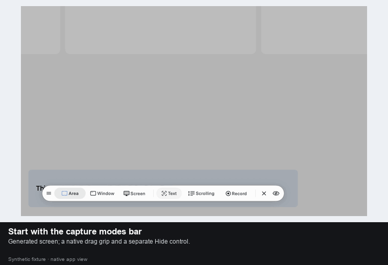

# Capture toolbar

The system pointer appears over the capture toolbar instead of disappearing behind its controls. The canvas keeps its capture pointer; moving between them balances the overlay's single cursor hide, including cancellation and the transition to selection setup.

Drag the grip at the left to move either the capture mode bar or the selected area's action bar. The bar stays within the display. A moved action bar stays in place when the selection is adjusted; a new capture session starts at the default position.

Click the eye-slash button to hide the toolbar, or press **H** to hide/show it. Hidden bars leave the selection's hit testing, so a drag can begin where the toolbar used to be. A hidden choice carries into selection setup. H does not intercept modified shortcuts or typing in a size field. Return and the existing capture keys still work with the bar hidden.

The controls use native AppKit cursor rectangles, localized accessibility names and hide/recovery announcements. All updates happen on mouse/key events; no timers, polling or new dependencies are added.

## Demo

The GIF shows the real AppKit overlay and controller operated with native mouse/key input, over a generated test image. The image is injected through the existing debug fixture; no personal desktop content is recorded.
