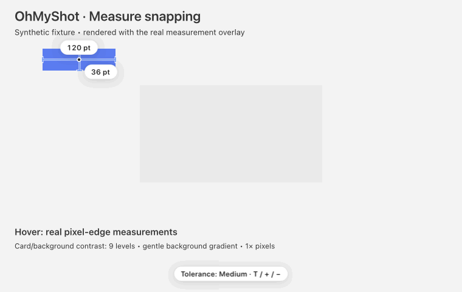

# Measurement snapping

Measure finds pixel boundaries on the frozen screen. Drag a box around content to fit its bounds;
click to clear the box. A capture's drag is not snapped to pixels; once the area is framed, B fits it the same way
(see [Fitting a framed area](#fitting-a-framed-area)).



## Controls

Settings → Tools provides **Measurement snapping** and **Edge tolerance**. Snapping starts enabled;
turning it off keeps boxes exactly as drawn while pointer measurements remain available. Hold Command
when releasing a drag to skip snapping once.

The tolerance presets are Zero, Low, Medium (default), and High. Lower tolerance finds finer edges;
higher tolerance ignores small color changes. **T** cycles presets and **+/−** adjusts them while
measuring. The setting persists and applies across displays. **Tab** switches pixels and points.

**F** keeps the display as a screenshot with the measurement on it as marks you can edit: each line a
double-headed arrow with its length, or the box as a rectangle with its size, in the unit shown. It is
delivered as any screenshot is, so it goes to History, the clipboard, a Quick Access card, or a saved
file as Settings → Screenshots → After screenshot says. **Return** and **⌘C** still copy the reading.

## Detection and responsiveness

Strong RGB transitions keep precise pixel endpoints. Faint edges need local contrast above the
surrounding gradient and spatial support. Area detection joins supported boundary contours, preserves
thin details, and rejects isolated distant specks only when a strong closed outline provides context.
It abstains on smooth patches with no clear border, preserving the user's drawn box.

Pointer measurements scan rows and columns without allocating a full-screen edge map. Selections
above 250,000 physical pixels find their edges in the background and show “Finding edges…”. New
selections, tolerance changes, replacement frames, and closing the overlay cancel stale work.

Pixel evidence cannot always distinguish a faint border from its shadow. Some ambiguous border/shadow
fixtures differ by one physical pixel. Results on photographs and busy backgrounds depend on the
selected content and tolerance; this feature does not infer semantic objects.

## Fitting a framed area

In All-In-One's framed area and in Capture Area's or Annotate Area's size control (Tab), **B** fits the
area to the edges of what it holds on the frozen screen, with the same detector at the Edge tolerance
set for Measure, read from Settings each time a capture opens. The area only closes in on its content,
staying inside the area framed, keeps any shape it keeps, and is never smaller than 16 points either
way; where that can't fit inside the area framed, it stays as drawn. **B** again, or **Command-Z**,
puts back the area as drawn, until something else moves or resizes it, even back to where the fit
left it. Areas above 250,000 physical pixels are looked at in the background, reading
only that part of the frozen frame and a 16-pixel margin; moving the area or closing the overlay drops
the work. A live screen (Freeze off) has no frame to read, so B does nothing there.

## Validation

Synthetic tests cover 1×/2× geometry, RGB thresholds, antialiasing, low-contrast cards, gradients,
thin lines, narrow opposite-polarity edges, noise, persistence, reused overlay sessions, and background
result invalidation. The GIF is a deterministic render of the real measurement overlay on generated content, not a screen recording. Each selection and tolerance result is checked before its frame is written. See [the reproducible renderer](../Tools/measure-demo/README.md).

Run the focused package checks from the repository root:

```sh
Scripts/test.sh --filter 'PixelGridTests|PixelGridQualityTests|MeasureOverlayTests|OverlayKeyTests|MeasureToleranceSettingTests|AreaFitTests'
```

The tests validate explicit local geometry and behavior. They are not a broad accuracy benchmark or a
runtime comparison against another application.
