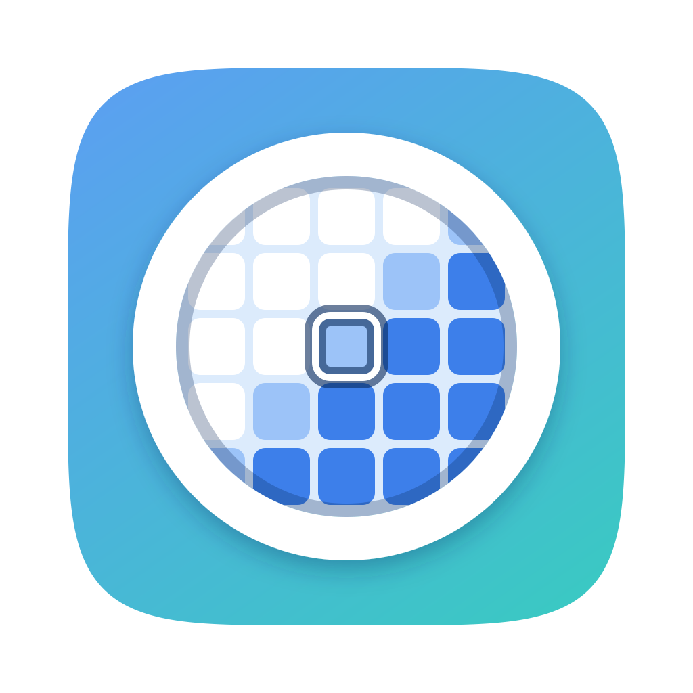
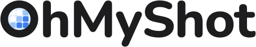
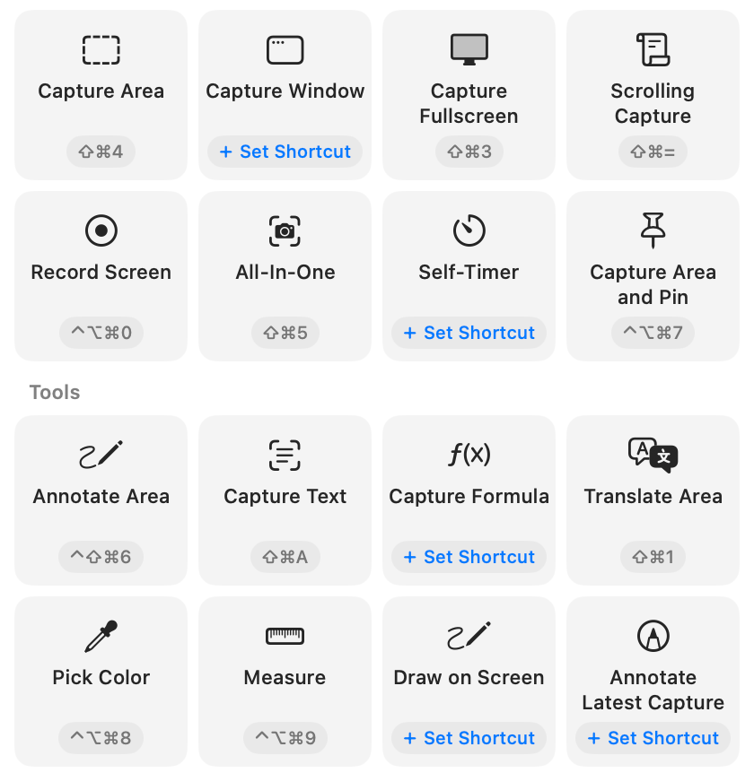

<!-- The icon is Tools/logo/make_icon.py's preview and the wordmark Tools/logo/make_wordmark.py's output: outlined
     paths, so both render on GitHub without fonts.
     The English line under it is also the repository description and OhMyShot's card on the MMFoundation profile
     (MMFoundation/.github, profile/README.md and README.zh-CN.md): change them together. Other pages link to
     #build-and-run, so keep that heading. README.zh-CN.md is the Chinese translation: change it in the same commit. -->

<p align="center">
  <picture>
    <source media="(prefers-color-scheme: dark)" srcset="Tools/logo/preview/icon-dark.svg">
    
  </picture>
</p>

<h1 align="center">
  <picture>
    <source media="(prefers-color-scheme: dark)" srcset="Tools/logo/preview/wordmark-dark.svg">
    
  </picture>
</h1>

<p align="center">
  <b>A native macOS capture tool — screenshots, recordings, annotation, pins, and on-device OCR — built to cost nothing while it waits in the menu bar.</b>
</p>

<p align="center">
  一个原生 macOS 截图工具：截图、录屏、标注、贴图和端侧 OCR，常驻菜单栏时几乎不耗电。
</p>

<p align="center">
  <a href="https://github.com/MMFoundation/OhMyShot/releases/latest"></a>
</p>

<p align="center">
  <a href="https://github.com/MMFoundation/OhMyShot/releases/latest"></a>
  
  
  <a href="LICENSE"></a>
  <a href="#contributing"></a>
  <a href="https://mmfoundation.dev/discord"></a>
</p>

<p align="center">
  <b>English</b>&ensp;|&ensp;<a href="README.zh-CN.md">简体中文</a>
</p>

<p align="center">
  <a href="#why-ohmyshot">Why OhMyShot</a>&ensp;·&ensp;
  <a href="#features">Features</a>&ensp;·&ensp;
  <a href="#power-budget">Power budget</a>&ensp;·&ensp;
  <a href="#getting-started">Getting started</a>&ensp;·&ensp;
  <a href="#contributing">Contributing</a>&ensp;·&ensp;
  <a href="CHANGELOG.md">Changelog</a>
</p>

<!-- Rendered by a Debug build (ohmyshot-dev://debug/updates-menu?render=1&mode=light, and mode=dark) and cropped to the
     tiles, which leaves out the build's name and its Debug row; the shortcuts are that Mac's. Render both again when the
     launcher changes. README.zh-CN.md uses the same pictures. -->
<p align="center">
  <picture>
    <source media="(prefers-color-scheme: dark)" srcset="Docs/assets/capture-launcher-dark.png">
    
  </picture>
  <br>
  <sub>One click on the menu bar icon opens the capture launcher.</sub>
</p>

## Why OhMyShot

<table>
  <tr>
    <td width="50%" valign="top">
      <h3>🪶 Idle means idle</h3>
      In the menu bar it runs no timers, polls nothing, and holds no capture streams or event taps:
      <b>0 wakeups</b> and <b>26 MB</b> after launch. Every number is <a href="#power-budget">measured and published</a>, misses included.
    </td>
    <td width="50%" valign="top">
      <h3>🔤 Text in pixels is data</h3>
      Copy the text from any part of the screen, search your capture history by it (Chinese included), translate it
      in place, and read tables, formulas, and charts with optional on-device model packs.
    </td>
  </tr>
  <tr>
    <td width="50%" valign="top">
      <h3>🔒 Private by default</h3>
      Everything is read on your Mac. There is no OhMyShot server: uploads go only to storage you own, and a cloud OCR
      model runs only with your own API key, when you turn it on.
    </td>
    <td width="50%" valign="top">
      <h3>🍎 Native, free, and open</h3>
      Swift 6, SwiftUI, and AppKit, following macOS conventions down to permissions and VoiceOver. GPL-3.0, with no
      subscription and no paid upgrades.
    </td>
  </tr>
</table>

## Features

<table>
  <tr>
    <td width="50%" valign="top">
      <h3>📸 Screenshots</h3>
      Area, window (with or without its shadow, on a background), full display, the previous area, and a self-timer.
      Areas can cross displays, and the screen freezes while you choose. All-In-One sets up any of them from one bar.
    </td>
    <td width="50%" valign="top">
      <h3>🗂️ Quick Access and Capture History</h3>
      A card for each capture to copy, save, mark up, pin, upload, or drag out, and a history you can search by the
      text in the pictures.
    </td>
  </tr>
  <tr>
    <td width="50%" valign="top">
      <h3>✏️ Annotation</h3>
      An editor, or drawing straight on the frozen selection: arrows, shapes, text, a highlighter that snaps to text,
      counters, blur and pixelation (with redaction suggestions from the text it reads), crops, backgrounds, combined
      images, and project files you can open again.
    </td>
    <td width="50%" valign="top">
      <h3>🔤 Text from pixels</h3>
      Capture Text copies the text in an area; the Recognized Text window shows it beside the picture with tables, links,
      and codes, and translates it, also over the original. Optional model packs read Chinese a second time, formulas as
      LaTeX, and tables and charts. <a href="Docs/ocr.md">How it works →</a>
    </td>
  </tr>
  <tr>
    <td width="50%" valign="top">
      <h3>🎬 Recording and Studio</h3>
      Screen, window, or area to MP4 or GIF, with system audio, microphone, camera, clicks, and keys. Studio edits a
      recording afterwards, with automatic zooms that follow the cursor. On macOS 27, with Replay on, the last 15 seconds
      can be saved at any time.
    </td>
    <td width="50%" valign="top">
      <h3>📌 Pins, color, and measuring</h3>
      Always-on-top pictures, text, and colors; a screen color picker and a pixel ruler that snaps to edges.
      <a href="Docs/measurement-snapping.md">Edge snapping →</a>
    </td>
  </tr>
  <tr>
    <td width="50%" valign="top">
      <h3>📜 Scrolling capture</h3>
      Scroll by hand or let Auto-scroll do it, into one long picture.
    </td>
    <td width="50%" valign="top">
      <h3>☁️ Sharing</h3>
      Uploads to your own S3-compatible, WebDAV, or custom HTTP storage; printing, email, and the Share menu.
    </td>
  </tr>
  <tr>
    <td width="50%" valign="top">
      <h3>⚙️ Automation</h3>
      CleanShot X–compatible URL commands under <code>ohmyshot://</code>, actions in Shortcuts and Spotlight, and a
      Raycast extension. <a href="Docs/automation.md">URL commands →</a>
    </td>
    <td width="50%" valign="top">
      <h3>🌐 Languages</h3>
      English, Simplified and Traditional Chinese, Japanese, Spanish, and French.
      <a href="Docs/localization.md">Add a translation →</a>
    </td>
  </tr>
</table>

OhMyShot also appears in other apps' Share menu (to mark up or pin a picture; switch it on in System Settings ›
General › Login Items & Extensions › Sharing) and in Finder's Open With for images.

## Power budget

Every milestone is gated on measured numbers. The latest, with Debug builds on an Apple silicon Mac running macOS 27 beta
(a 6K ultrawide beside a built-in XDR display):

| Metric | Target | Measured |
| --- | --- | --- |
| Idle CPU after launch (60 s average) | 0.0% | 0.06–0.09%, from macOS updating the menu bar; no timers of the app's own |
| Idle wakeups | < 1 per second | **0** ✅ |
| Memory after launch | < 30 MB | **26 MB** ✅ |
| Memory after use, idle | < 60 MB | 57 MB after recording ✅; 68 MB after reading formulas and tables ❌ |
| Shortcut → selection overlay | p95 < 50 ms | **p95 9.8 ms** ✅ |
| Shortcut → frozen picture | p95 < 150 ms | **p95 47.7 ms** ✅ |
| Text from a 1000 × 600 px area | < 300 ms | p50 187 ms ✅, p95 370 ms ❌ |
| Recording 1080p at 60 fps | < 15% CPU | 15.7% ❌ |
| App size, without model packs | < 30 MB | 37 MB (14 MB zipped) ❌ |

Model packs run in a helper process that exits when it is done, so they cost the app's own memory nothing. The full
log, with methods, dates, and caveats, is in [Docs/perf.md](Docs/perf.md); measure your own Mac with
`Scripts/power-sample.sh` and `Scripts/latency.sh`.

## Getting started

### Install

1. Download `OhMyShot-<version>.dmg` from the [latest release](https://github.com/MMFoundation/OhMyShot/releases/latest).
2. Open it and drag OhMyShot onto Applications.
3. Open OhMyShot. A getting-started guide walks you through allowing Screen Recording and your first capture.

Releases are signed with a Developer ID and notarized by Apple, and the app keeps itself up to date from then on
(Settings › General › Updates).

### Requirements

- macOS 26 or later on Apple silicon
- Xcode 27 or later (the app is built with the macOS 27 SDK), with its Metal Toolchain (the VLM pack's MLX kernels
  need it): `xcodebuild -downloadComponent MetalToolchain`
- [XcodeGen](https://github.com/yonaskolb/XcodeGen): `brew install xcodegen`

### Build and run

```sh
git clone https://github.com/MMFoundation/OhMyShot.git
cd OhMyShot
Scripts/bootstrap.sh   # generate OhMyShot.xcodeproj from project.yml
Scripts/run.sh         # build the Debug app ("OhMyShot Dev") and launch it
Scripts/test.sh        # run both packages' unit tests (OhMyShotKit, OhMyShotVLM)
```

`build.sh` and `run.sh` regenerate the project when `project.yml` changes. Debug builds use their own bundle
identifier (`….ohmyshot.dev`), URL scheme (`ohmyshot-dev://`), and default shortcuts (⌃⌥⌘ plus a digit), so they
can run next to a release build without fighting over permissions or shortcuts.

### Signing and Screen Recording permission

macOS ties the Screen Recording permission to the app's code signature, so an ad-hoc signed build looks like a new
app after every rebuild and loses it. To keep it, copy `Config/Signing.local.xcconfig.example` to
`Config/Signing.local.xcconfig` and fill in your Apple Development team (a free personal team works).

> [!TIP]
> After you grant Screen Recording, relaunch the app: macOS applies the permission only to new processes.
> `Scripts/reset-tcc.sh` clears the Debug build's permissions when you want to start over.

### Updates

Release builds check for updates with [Sparkle](https://sparkle-project.org) about once a day (Settings › General ›
Updates), using signed appcasts attached to this repository's GitHub releases; Debug builds never check. How releases
are made, signed, and notarized is in [Docs/release.md](Docs/release.md).

### Optional usage data

Settings › General › Usage Data is off by default. If enabled, OhMyShot sends the UTC date,
a random ID that changes each UTC day, the app version, macOS major version, and daily counts
of successful screenshots, recordings, and text recognitions to `www.ohmyshot.org`. Reports
exclude captures, recognized text, file and window names, and persistent device identifiers.
When the app runs, it retries unsent counts from the last seven UTC days and drops older reports. Turning the setting off stops sending
and clears the local report file. Debug builds leave the reporting service inactive.

## Documentation

| Document | What it covers |
| --- | --- |
| [Docs/automation.md](Docs/automation.md) | URL commands, Shortcuts, Spotlight, and the Raycast extension |
| [Docs/ocr.md](Docs/ocr.md) | How text recognition is layered, and its benchmark |
| [Docs/capture-picker.md](Docs/capture-picker.md) | The magnifier at the pointer while you choose an area |
| [Docs/measurement-snapping.md](Docs/measurement-snapping.md) | The pixel ruler's edge snapping |
| [Docs/localization.md](Docs/localization.md) | Adding or improving a translation |
| [Docs/perf.md](Docs/perf.md) | Every performance and power measurement |
| [Docs/release.md](Docs/release.md) | Building, signing, and notarizing a release |
| [PRODUCT.md](PRODUCT.md) and [DESIGN.md](DESIGN.md) | What OhMyShot is for, and how it should look and feel |

## Contributing

Contributions are welcome, whether code, translations, bug reports, or measurements from a Mac other than ours.

- **Report a bug or ask for a feature** in [Issues](https://github.com/MMFoundation/OhMyShot/issues). Include
  your macOS version, your displays, and the steps that lead to the problem.
- **Ask a question or talk with us** on MMFoundation's [Discord](https://mmfoundation.dev/discord).
- **Translate.** You don't need Xcode: [Docs/localization.md](Docs/localization.md) explains how.
- **Send a pull request.** Run `Scripts/test.sh` before you push, and write commit messages as
  [Conventional Commits](https://www.conventionalcommits.org) (`feat(ocr): …`, `fix(studio): …`). Changes that
  could affect idle cost or latency should come with numbers from `Scripts/power-sample.sh` or `Scripts/latency.sh`.
  Read [PRODUCT.md](PRODUCT.md) and [DESIGN.md](DESIGN.md) before larger changes.

### Contributors

<a href="https://github.com/MMFoundation/OhMyShot/graphs/contributors">
  
</a>

## Sponsors

OhMyShot is a project of [MMFoundation](https://mmfoundation.dev/), which takes sponsorship on
[Open Collective](https://opencollective.com/mmfoundation), where every contribution and every expense is
public. Sponsors appear here: a company with its logo and a link, a person with their avatar. Sponsoring
unlocks nothing; OhMyShot is free and complete for everyone.

<!-- MMFoundation's sponsors, drawn by Open Collective and kept current there (its images are
     cached for up to a day): each company's logo links to its website, and people's avatars to the
     Collective. While no company sponsors, the first logo slot is Open Collective's Contribute button.
     The slots run from the middle out (8 6 4 2 0 1 3 5 7 9), so the first sponsor stands in the
     middle and the row stays centred while slots are empty.
     The same block is in WallpaperMachine's README. -->
<p align="center">
  <a href="https://opencollective.com/mmfoundation/organization/8/website"></a>
  <a href="https://opencollective.com/mmfoundation/organization/6/website"></a>
  <a href="https://opencollective.com/mmfoundation/organization/4/website"></a>
  <a href="https://opencollective.com/mmfoundation/organization/2/website"></a>
  <a href="https://opencollective.com/mmfoundation/organization/0/website"></a>
  <a href="https://opencollective.com/mmfoundation/organization/1/website"></a>
  <a href="https://opencollective.com/mmfoundation/organization/3/website"></a>
  <a href="https://opencollective.com/mmfoundation/organization/5/website"></a>
  <a href="https://opencollective.com/mmfoundation/organization/7/website"></a>
  <a href="https://opencollective.com/mmfoundation/organization/9/website"></a>
</p>
<p align="center">
  <a href="https://opencollective.com/mmfoundation"></a>
</p>

## Acknowledgments

OhMyShot is built with [Sparkle](https://sparkle-project.org),
[KeyboardShortcuts](https://github.com/sindresorhus/KeyboardShortcuts),
[MLX Swift](https://github.com/ml-explore/mlx-swift), and
[Swift Numerics](https://github.com/apple/swift-numerics). Their notices are in
[App/Acknowledgments.md](App/Acknowledgments.md).

## License

OhMyShot is free software, licensed under the [GNU General Public License v3.0](LICENSE).
Copyright © 2026 OhMyShot contributors.

## Friend Link

- [linux.do](https://linux.do) —— Where possible begins

<br>

<p align="center">
  <picture>
    <source media="(prefers-color-scheme: dark)" srcset="Tools/logo/preview/icon-dark.svg">
    
  </picture>
  <br>
  <sub>OhMyShot is a project of <a href="https://mmfoundation.dev/">MMFoundation</a>&ensp;·&ensp;<a href="#top">Back to top ↑</a></sub>
</p>
