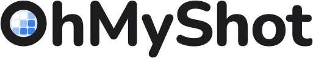

<!-- The wordmark is Tools/logo/make_wordmark.py's output: outlined paths, so it renders on GitHub without fonts.
     The English line under it is also the repository description and OhMyShot's card on the MMFoundation profile
     (MMFoundation/.github, profile/README.md and README.zh-CN.md): change them together. Other pages link to
     #build-and-run, so keep that heading. -->

<h1 align="center">
  <picture>
    <source media="(prefers-color-scheme: dark)" srcset="Tools/logo/preview/wordmark-dark.svg">
    
  </picture>
</h1>

<p align="center">
  A native macOS capture tool — screenshots, recordings, annotation, pins, and on-device OCR — built to cost nothing while it waits in the menu bar.
</p>

<p align="center">
  一个原生 macOS 截图工具：截图、录屏、标注、贴图和端侧 OCR，常驻菜单栏时几乎不耗电。
</p>

<p align="center">
  <a href="https://github.com/BenjaminD2023/OhMyShot/releases"></a>
  
  <a href="LICENSE"></a>
</p>

<p align="center">
  <a href="#what-it-does">What it does</a>&ensp;·&ensp;
  <a href="#power-budget">Power budget</a>&ensp;·&ensp;
  <a href="#build-and-run">Build and run</a>&ensp;·&ensp;
  <a href="#automation">Automation</a>&ensp;·&ensp;
  <a href="#languages">Languages</a>&ensp;·&ensp;
  <a href="CHANGELOG.md">Changelog</a>
</p>

This is [BenjaminD2023's maintained fork](https://github.com/BenjaminD2023/OhMyShot) of [fzlzjerry/OhMyShot](https://github.com/fzlzjerry/OhMyShot). It preserves the local capture, pixel-picker, shortcut, OCR, preview and toolbar improvements, including proposals that were not merged upstream. Updates and packaged builds come from this fork.

Download the Apple silicon build from [Releases](https://github.com/BenjaminD2023/OhMyShot/releases). The DMG contains the app and an Applications shortcut. The first fork release is not Apple-notarized; its update feed and update archives are signed independently with Sparkle's Ed25519 key. See [release and signing instructions](Docs/releasing.md).

这是独立维护的 fork，保留本地增强功能；安装包和自动更新均来自本 fork。

## What it does

| Feature | What it does |
| --- | --- |
| **Screenshots** | Area, window (with or without its shadow, on a background), full display, the previous area, and a self-timer; areas can cross displays, and the screen freezes while you choose. All-In-One sets up any of them from one bar. |
| **Quick Access and Capture History** | A card for each capture to copy, save, mark up, pin, upload, or drag out, and a history you can search by the text in the pictures (Chinese included). |
| **Annotation** | An editor, or drawing straight on the frozen selection: arrows, shapes, text, highlighter that snaps to text, counters, blur and pixelation (with redaction suggestions from the text it reads), crops, backgrounds, combined images, and project files you can open again. |
| [**Text from pixels**](Docs/ocr.md) | Capture Text copies the text in an area; the Recognized Text window shows it beside the picture with tables, links, and codes, and translates it, also over the original. Optional downloadable model packs read Chinese a second time, formulas as LaTeX, and tables and charts; a cloud model with your own API key and the text native apps report can refine it further. Everything is read on the Mac unless you set up the cloud model. |
| [**Pins, color, and measuring**](Docs/measurement-snapping.md) | Always-on-top pictures, text, and colors; a screen color picker and a pixel ruler that snaps to edges. |
| **Recording** | Screen, window, or area to MP4 or GIF, with system audio, microphone, camera, clicks, and keys; Studio edits a recording afterwards, with automatic zooms that follow the cursor. On macOS 27, with Replay turned on, the last 15 seconds can be saved at any time. |
| **Scrolling capture** | Scroll by hand or let Auto-scroll do it, into one long picture. |
| **Sharing** | Uploads to your own storage (S3-compatible, WebDAV, or a custom HTTP endpoint), never a service of ours; printing, email, and the Share menu. |

[CHANGELOG.md](CHANGELOG.md) lists the changes so far, with their commits and contributors.

## Power budget

When no capture is active, the app holds no capture streams or screenshot event taps. Sparkle checks this fork for updates on its standard daily schedule; automatic checks and downloads can be changed in Settings › General. The original capture power targets and upstream measurements (not remeasured for this fork) follow:

| Metric | Target | Measured |
| --- | --- | --- |
| Idle CPU after launch (60 s average) | 0.0% | 0.06–0.09%, seconds that came with macOS updating the menu bar; no timers of the app's own (M6, 2026-10-19) |
| Idle wakeups | < 1 per second | 0 |
| Memory footprint after launch | < 30 MB | 26 MB |
| Memory footprint after use, idle | < 60 MB | 57 MB after recording, a GIF, and a Studio film (M4); 68 MB after reading text, formulas, and tables (M6); 110–130 MB while Vision's models stay loaded after the Recognized Text window (M2–M6) |
| Shortcut to the selection overlay on screen | p95 < 50 ms | p95 9.8 ms over 50 runs (M1); 18.9 ms on one real press with the screen frozen, the default since M3 |
| Shortcut to the frozen picture | p95 < 150 ms | p95 47.7 ms over 50 runs (M1); 54–106 ms over 23 real presses since (median about 73) |
| Text from an area of about 1000 × 600 px | < 300 ms | p50 187 ms, p95 370 ms over 27 test pages (M2): met at p50, not at p95 |
| Recording 1920 × 1080 at 60 fps | < 15% CPU | 15.7% (app 8.4%, encoder 4.4%, `replayd` 2.9%; the window server not counted) |
| App size, without model packs | < 30 MB | 37 MB as `Scripts/release.sh` builds it, stripped (14 MB zipped; 60 MB unstripped), 2026-10-20 |

The optional model packs are read in a helper process that exits when it is done, so they cost the app's own memory
nothing; the helper itself takes up to 2.6 GB while the table model reads.

## Requirements

- macOS 26 or later on Apple silicon
- Xcode 27 or later, with its Metal Toolchain (used by the optional VLM pack):
  `xcodebuild -downloadComponent MetalToolchain`
- [XcodeGen](https://github.com/yonaskolb/XcodeGen): `brew install xcodegen`

## Build and run

```sh
Scripts/bootstrap.sh   # generate OhMyShot.xcodeproj from project.yml (build.sh and run.sh do it again when project.yml has changed)
Scripts/run.sh         # build the Debug app ("OhMyShot Dev") and launch it
Scripts/test.sh        # both packages' unit tests (OhMyShotKit, OhMyShotVLM)
```

Debug builds use their own bundle identifier (`….ohmyshot.dev`), URL scheme (`ohmyshot-dev://`), and default shortcuts (⌃⌥⌘ plus a digit), so they can run next to a release build without fighting over permissions or shortcuts.

### Signing and Screen Recording permission

This fork keeps Hardened Runtime and library validation enabled. Before building, copy `Config/Signing.local.xcconfig.example` to the ignored `Config/Signing.local.xcconfig` and select an existing Apple Development identity for local use, or Developer ID Application for distribution. Use the certificate's actual organizational-unit Team ID. An ad-hoc build is insufficient for loading the separately distributed Sparkle framework with these protections enabled.

macOS ties Screen Recording permission to the app's code signature; a stable signing identity also avoids treating every rebuild as a new app. `Scripts/reset-tcc.sh` clears the Debug build's permissions when needed.

After you grant Screen Recording, relaunch the app: macOS applies the permission only to new processes.

## Automation

OhMyShot answers CleanShot X's URL commands under `ohmyshot://`, offers actions in Shortcuts and Spotlight, and
comes with a Raycast extension. See [Docs/automation.md](Docs/automation.md).

## Share menu, Open With, and email

OhMyShot is in the Share menu of other apps (Preview, Safari, Photos, Finder) for pictures, to mark them up or pin
them; switch it on in System Settings › General › Login Items & Extensions › Sharing. It also appears in Finder's
Open With for images, and a capture's Quick Access card and its row in Capture History can start an email with the
file attached.

## Languages

OhMyShot is in English, Simplified and Traditional Chinese, Japanese, Spanish, and French. It follows the system's
language, or the one chosen in Settings › General. To add or improve a translation, you don't need Xcode: see
[Docs/localization.md](Docs/localization.md).

## Updates and releases

Release builds look for updates with [Sparkle](https://sparkle-project.org) about once a day (Settings › General ›
Updates), in signed appcasts attached to this repository's GitHub releases; debug builds never look. How releases are
packaged and signed is in [Docs/releasing.md](Docs/releasing.md). Fork builds use Apple Development signing and are not Apple-notarized.

## License

OhMyShot is free software, licensed under the [GNU General Public License v3.0](LICENSE).
Copyright © 2026 OhMyShot contributors.
