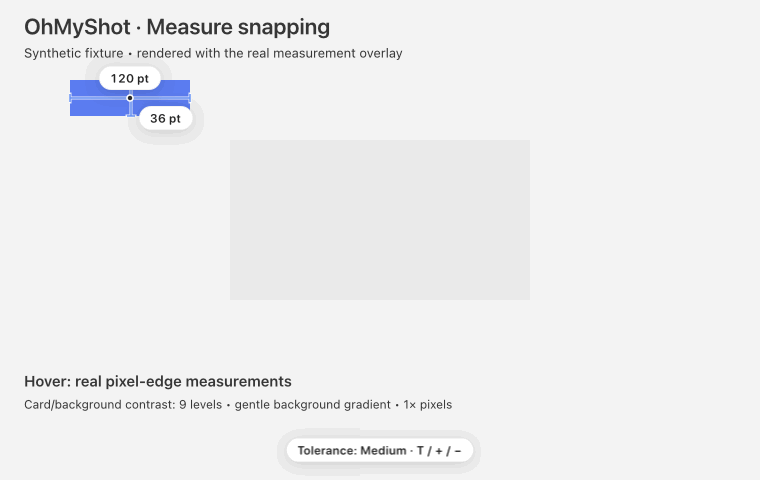

<!-- The icon is Tools/logo/make_icon.py's preview and the wordmark Tools/logo/make_wordmark.py's output: outlined
     paths, so both render on GitHub without fonts.
     The English line under it is also the repository description and OhMyShot's card on the MMFoundation profile
     (MMFoundation/.github, profile/README.md and README.zh-CN.md): change them together. Other pages link to
     #build-and-run, so keep that heading. README.zh-CN.md is the Chinese translation: change it in the same commit. -->

<p align="center">
  <picture>
    <source media="(prefers-color-scheme: dark)" srcset="Tools/logo/preview/icon-dark.svg">
    
  </picture>
</p>

<h1 align="center">
  <picture>
    <source media="(prefers-color-scheme: dark)" srcset="Tools/logo/preview/wordmark-dark.svg">
    
  </picture>
</h1>

<p align="center">
  <b>A native macOS capture tool — screenshots, recordings, annotation, pins, and on-device OCR — built to cost nothing while it waits in the menu bar.</b>
</p>

<p align="center">
  一个原生 macOS 截图工具：截图、录屏、标注、贴图和端侧 OCR，常驻菜单栏时几乎不耗电。
</p>

<p align="center">
  <a href="https://github.com/BenjaminD2023/OhMyShot/releases"></a>
  
  <a href="LICENSE"></a>
</p>

<p align="center">
  <b>English</b>&ensp;|&ensp;<a href="README.zh-CN.md">简体中文</a>
</p>

<p align="center">
  <a href="https://www.ohmyshot.org/">Website &amp; Demo</a>&ensp;·&ensp;
  <a href="#why-ohmyshot">Why OhMyShot</a>&ensp;·&ensp;
  <a href="#features">Features</a>&ensp;·&ensp;
  <a href="#power-budget">Power budget</a>&ensp;·&ensp;
  <a href="#getting-started">Getting started</a>&ensp;·&ensp;
  <a href="#contributing">Contributing</a>&ensp;·&ensp;
  <a href="CHANGELOG.md">Changelog</a>
</p>

This is [BenjaminD2023's maintained fork](https://github.com/BenjaminD2023/OhMyShot) of [MMFoundation/OhMyShot](https://github.com/MMFoundation/OhMyShot) (formerly fzlzjerry/OhMyShot). It preserves the local capture, pixel-picker, shortcut, OCR, preview and toolbar improvements, including proposals that were not merged upstream. Updates and packaged builds come from this fork.

Download the Apple silicon build from [Releases](https://github.com/BenjaminD2023/OhMyShot/releases). The DMG contains the app and an Applications shortcut. Fork releases are not Apple-notarized; the fork’s update feed and update archives are signed independently with Sparkle's Ed25519 key. See [release and signing instructions](Docs/releasing.md).

这是独立维护的 fork，保留本地增强功能；安装包和自动更新均来自本 fork。

## Why OhMyShot

<table>
  <tr>
    <td width="50%" valign="top">
      <h3>🪶 Idle means idle</h3>
      In the menu bar it runs no timers, polls nothing, and holds no capture streams or event taps:
      upstream measured <b>0 wakeups</b> and <b>26 MB</b> after launch (not remeasured for this fork; Sparkle adds scheduled update checks). Every number is <a href="#power-budget">measured and published</a>, misses included.
    </td>
    <td width="50%" valign="top">
      <h3>🔤 Text in pixels is data</h3>
      Copy the text from any part of the screen, search your capture history by it (Chinese included), translate it
      in place, and read tables, formulas, and charts with optional on-device model packs.
    </td>
  </tr>
  <tr>
    <td width="50%" valign="top">
      <h3>🔒 Local-first &amp; transparent</h3>
      Captures, recognized text, file names, and clipboard contents stay on your Mac by default — they leave your Mac
      only when you explicitly share them (via email, macOS Share, or uploads to storage you own) or enable cloud OCR
      with your own API key, and are never sent to MMFoundation. Release builds send <a href="#optional-usage-data">anonymous daily usage counts</a> (on by default
      since v0.3.0, one-click opt-out in Settings › General › Usage Data;
      <a href="https://www.ohmyshot.org/privacy/">Privacy Notice</a>).
    </td>
    <td width="50%" valign="top">
      <h3>🍎 Native, free, and open</h3>
      Swift 6, SwiftUI, and AppKit, following macOS conventions down to permissions and VoiceOver. GPL-3.0, with no
      subscription and no paid upgrades.
    </td>
  </tr>
</table>

## Features

<table>
  <tr>
    <td width="50%" valign="top">
      <h3>📸 Screenshots</h3>
      Area, window (with or without its shadow, on a background), full display, the previous area, and an interactive
      self-timer (<code>D</code> or <code>1</code>–<code>5</code> on screen, <code>Esc</code> to cancel). Areas can
      cross displays, and the screen freezes while you choose. All-In-One sets up any of them from one bar.
    </td>
    <td width="50%" valign="top">
      <h3>🗂️ Quick Access and Capture History</h3>
      A card for each capture (dockable to any of the four screen corners) to copy, save, mark up, pin, upload, or drag
      out, plus a searchable history with text-in-image search, date and app filters, multi-select, 5-second Undo Trash,
      and multi-column collages.
    </td>
  </tr>
  <tr>
    <td width="50%" valign="top">
      <h3>✏️ Annotation</h3>
      An editor, or drawing straight on the frozen selection: arrows, shapes with adjustable corner radius, text, a
      highlighter that snaps to text, counters, Magnifier, Erase, blur and pixelation (with redaction suggestions from
      recognized text), tool locking, cross-editor copy/paste, crops, backgrounds, and <code>.ohmyshot</code> project
      files you can open again.
    </td>
    <td width="50%" valign="top">
      <h3>🔤 Text from pixels</h3>
      Capture Text copies text from any area (stripping narrow code-editor gutter line numbers); the zoomable Recognized
      Text window supports inline table editing with CSV/TSV export, link and QR/barcode actions, and Translation Lens
      over the original image. Optional on-device model packs improve CJK accuracy, convert formulas to LaTeX with
      configurable delimiters, and read tables and charts (with custom download mirror support).
      <a href="Docs/ocr.md">How it works →</a>
    </td>
  </tr>
  <tr>
    <td width="50%" valign="top">
      <h3>🎬 Recording and Studio</h3>
      Screen, window, or area to MP4 or GIF (with frame-rate and size presets), with system audio, live microphone meter
      and mute, camera (with background blur or removal), clicks, and keys. Studio edits recordings with timeline audio
      waveforms, master fades, non-destructive crop, draggable speed stretches (0.5×–4×) and cuts, cursor-following or
      fixed zooms, and portable <code>.omsstudio</code> project packages. On macOS 27, with Replay on, the last 15
      seconds can be saved at any time.
    </td>
    <td width="50%" valign="top">
      <h3>📌 Pins, color, and measuring</h3>
      Always-on-top pictures, text, and wide-gamut colors (restore up to 5 recently closed pins); a screen color picker
      and a pixel ruler that snaps to edges. <a href="Docs/measurement-snapping.md">Edge snapping →</a>
    </td>
  </tr>
  <tr>
    <td width="50%" valign="top">
      <h3>📜 Scrolling capture</h3>
      Four-direction scrolling (down, up, left, or right) by hand or with adjustable-speed Auto-scroll, stitched into
      one long picture.
    </td>
    <td width="50%" valign="top">
      <h3>☁️ Sharing</h3>
      Uploads to your own S3-compatible (including Cloudflare R2), WebDAV, or custom HTTP storage (ShareX
      <code>.sxcu</code> import supported); printing, email, and the Share menu.
    </td>
  </tr>
  <tr>
    <td width="50%" valign="top">
      <h3>⚙️ Automation &amp; CleanShot X migration</h3>
      Drop-in CleanShot X URL compatibility: swap <code>cleanshot://</code> to <code>ohmyshot://</code> in existing
      scripts and workflows, plus OhMyShot commands (<code>capture-formula</code>, <code>annotate-area</code>,
      <code>translate-area</code>, <code>pick-color</code>, <code>measure</code>, <code>draw-on-screen</code>,
      <code>save-replay</code>, <code>pin-from-clipboard</code>, <code>toggle-pins</code>), Shortcuts and Spotlight
      actions, and a Raycast extension. <a href="Docs/automation.md">URL commands →</a>
    </td>
    <td width="50%" valign="top">
      <h3>🌐 Languages</h3>
      English, Simplified and Traditional Chinese, Japanese, Spanish, and French.
      <a href="Docs/localization.md">Add a translation →</a>
    </td>
  </tr>
</table>

OhMyShot also appears in other apps' Share menu (to mark up, pin, or recognize text in a picture; switch it on in
System Settings › General › Login Items & Extensions › Sharing) and in Finder's Open With for images.

<p align="center">
  
  <br>
  <sub>Measure snaps to UI edges in real pixels — <a href="https://www.ohmyshot.org/#try">try Capture Area, OCR, Measure, and Pick Color live in your browser →</a></sub>
</p>

## Power budget

When no capture is active, the app holds no capture streams or screenshot event taps. Sparkle checks this fork for updates on its standard daily schedule; automatic checks and downloads can be changed in Settings › General. The original capture power targets and upstream measurements (not remeasured for this fork) follow:

| Metric | Target | Measured |
| --- | --- | --- |
| Idle CPU after launch (60 s average) | 0.0% | 0.06–0.09%, from macOS updating the menu bar; no timers of the app's own |
| Idle wakeups | < 1 per second | **0** ✅ |
| Memory after launch | < 30 MB | **26 MB** ✅ |
| Memory after use, idle | < 60 MB | 57 MB after recording ✅; 68 MB after reading formulas and tables ❌ |
| Shortcut → selection overlay | p95 < 50 ms | **p95 9.8 ms** ✅ |
| Shortcut → frozen picture | p95 < 150 ms | **p95 47.7 ms** ✅ |
| Text from a 1000 × 600 px area | < 300 ms | p50 187 ms ✅, p95 370 ms ❌ |
| Recording 1080p at 60 fps | < 15% CPU | 15.7% ❌ |
| App size, without model packs | < 30 MB | 37 MB installed (v0.5.0 release: 14.5 MB DMG / 18.2 MB ZIP) ❌ |

Model packs run in a helper process that exits when it is done, so they cost the app's own memory nothing. The full
log, with methods, dates, and caveats, is in [Docs/perf.md](Docs/perf.md); measure your own Mac with
`Scripts/power-sample.sh` and `Scripts/latency.sh`.

## Getting started

### Install

Download the DMG from this fork’s [latest release](https://github.com/BenjaminD2023/OhMyShot/releases/latest),
open it, and drag OhMyShot to Applications. Fork releases use Apple Development signing and are not Apple-notarized.
Updates use this fork’s signed feed (Settings › General › Updates); see [the fork release instructions](Docs/releasing.md).

### Requirements

- macOS 26 or later on Apple silicon
- Xcode 27 or later (the app uses the macOS 27 SDK), with its Metal Toolchain (used by the optional VLM pack):
  `xcodebuild -downloadComponent MetalToolchain`
- [XcodeGen](https://github.com/yonaskolb/XcodeGen): `brew install xcodegen`

### Build and run

```sh
git clone https://github.com/BenjaminD2023/OhMyShot.git
cd OhMyShot
Scripts/bootstrap.sh   # generate OhMyShot.xcodeproj from project.yml
Scripts/run.sh         # build the Debug app ("OhMyShot Dev") and launch it
Scripts/test.sh        # run both packages' unit tests (OhMyShotKit, OhMyShotVLM)
```

`build.sh` and `run.sh` regenerate the project when `project.yml` changes. Debug builds use their own bundle
identifier (`….ohmyshot.dev`), URL scheme (`ohmyshot-dev://`), and default shortcuts (⌃⌥⌘ plus a digit), so they
can run next to a release build without fighting over permissions or shortcuts.

### Signing and Screen Recording permission

This fork keeps Hardened Runtime and library validation enabled. Before building, copy `Config/Signing.local.xcconfig.example` to the ignored `Config/Signing.local.xcconfig` and select an existing Apple Development identity for local use, or Developer ID Application for distribution. Use the certificate's actual organizational-unit Team ID. An ad-hoc build is insufficient for loading the separately distributed Sparkle framework with these protections enabled.

macOS ties Screen Recording permission to the app's code signature; a stable signing identity also avoids treating every rebuild as a new app. `Scripts/reset-tcc.sh` clears the Debug build's permissions when needed.

> [!TIP]
> After you grant Screen Recording, relaunch the app: macOS applies the permission only to new processes.
> `Scripts/reset-tcc.sh` clears the Debug build's permissions when you want to start over.

### Updates

Release builds check this fork for signed updates with [Sparkle](https://sparkle-project.org) about once a day (Settings › General › Updates); Debug builds never check. See [Docs/releasing.md](Docs/releasing.md) for packaging and signing. Fork builds use Apple Development signing and are not Apple-notarized.

### Optional usage data

Settings › General › Usage Data is off by default and can be enabled there at any time; Reset to Default Settings keeps that choice. While it is on, OhMyShot sends `www.ohmyshot.org`
one report for each UTC day, updated as the day goes on, under a random ID that changes each UTC day. It says:

- how many times each feature was used (named as its keyboard shortcut is, `captureArea`), and whether from a shortcut, the
  menu bar, or automation (the URL API and Shortcuts);
- what came of it: screenshots, recordings, and text recognitions kept, uploads finished or failed, saves and copies that
  failed, and captures stopped for want of Screen Recording permission;
- the app version, macOS version (`26.4`), chip (`M3 Pro`), number of displays, and the app's language;
- whether Quick Access, copying, saving, and uploading after a capture are on, the screenshot format, and how long captures
  are kept;
- how long ago OhMyShot first ran, in spans (its first day, a week, a month, three months, a year), from the age of its
  Application Support folder;
- on how many of the 28 days before it something was used, counted on the Mac from the days it has seen while the setting
  was on.

Reports exclude captures, recognized text, file and window names, clipboard contents, and persistent device identifiers. The website merges
each report into daily totals, every detail counted on its own, and keeps the daily ID only to merge retries.
When the app runs, it retries unsent counts from the last seven UTC days and drops older reports. Turning the setting off stops sending
and clears the local report file, with the days it was used. Debug builds leave the reporting service inactive.

## Documentation

| Document | What it covers |
| --- | --- |
| [Docs/keyboard.md](Docs/keyboard.md) | Every key, from the capture overlay to the editor, pins, and History |
| [Docs/automation.md](Docs/automation.md) | URL commands, Shortcuts, Spotlight, and the Raycast extension |
| [Docs/ocr.md](Docs/ocr.md) | How text recognition is layered, and its benchmark |
| [Docs/capture-picker.md](Docs/capture-picker.md) | The magnifier at the pointer while you choose an area |
| [Docs/measurement-snapping.md](Docs/measurement-snapping.md) | The pixel ruler's edge snapping |
| [Docs/localization.md](Docs/localization.md) | Adding or improving a translation |
| [Docs/perf.md](Docs/perf.md) | Every performance and power measurement |
| [Docs/releasing.md](Docs/releasing.md) | Packaging, signing, and publishing this fork |
| [PRODUCT.md](PRODUCT.md) and [DESIGN.md](DESIGN.md) | What OhMyShot is for, and how it should look and feel |

## Contributing

Contributions are welcome, whether code, translations, bug reports, or measurements from a Mac other than ours.

- **Report a bug or ask for a feature** in [Issues](https://github.com/MMFoundation/OhMyShot/issues). Include
  your macOS version, your displays, and the steps that lead to the problem. For security vulnerabilities, please
  follow [SECURITY.md](SECURITY.md) instead of opening a public issue.
- **Ask a question or talk with us** on MMFoundation's [Discord](https://mmfoundation.dev/discord).
- **Translate.** You don't need Xcode: [Docs/localization.md](Docs/localization.md) explains how.
- **Send a pull request.** Run `Scripts/test.sh` before you push, and write commit messages as
  [Conventional Commits](https://www.conventionalcommits.org) (`feat(ocr): …`, `fix(studio): …`). Changes that
  could affect idle cost or latency should come with numbers from `Scripts/power-sample.sh` or `Scripts/latency.sh`.
  Read [PRODUCT.md](PRODUCT.md) and [DESIGN.md](DESIGN.md) before larger changes.

### Contributors

<a href="https://github.com/MMFoundation/OhMyShot/graphs/contributors">
  
</a>

## Sponsors

OhMyShot is a project of [MMFoundation](https://mmfoundation.dev/), which takes sponsorship on
[Open Collective](https://opencollective.com/mmfoundation), where every contribution and every expense is
public. Sponsors appear here: a company with its logo and a link, a person with their avatar. Sponsoring
unlocks nothing; OhMyShot is free and complete for everyone.

<!-- MMFoundation's sponsors, drawn by Open Collective and kept current there (its images are
     cached for up to a day): each company's logo links to its website, and people's avatars to the
     Collective. While no company sponsors, the first logo slot is Open Collective's Contribute button.
     The slots run from the middle out (8 6 4 2 0 1 3 5 7 9), so the first sponsor stands in the
     middle and the row stays centred while slots are empty.
     The same block is in WallpaperMachine's README. -->
<p align="center">
  <a href="https://opencollective.com/mmfoundation/organization/8/website"></a>
  <a href="https://opencollective.com/mmfoundation/organization/6/website"></a>
  <a href="https://opencollective.com/mmfoundation/organization/4/website"></a>
  <a href="https://opencollective.com/mmfoundation/organization/2/website"></a>
  <a href="https://opencollective.com/mmfoundation/organization/0/website"></a>
  <a href="https://opencollective.com/mmfoundation/organization/1/website"></a>
  <a href="https://opencollective.com/mmfoundation/organization/3/website"></a>
  <a href="https://opencollective.com/mmfoundation/organization/5/website"></a>
  <a href="https://opencollective.com/mmfoundation/organization/7/website"></a>
  <a href="https://opencollective.com/mmfoundation/organization/9/website"></a>
</p>
<p align="center">
  <a href="https://opencollective.com/mmfoundation"></a>
</p>

## Acknowledgments

OhMyShot is built with [Sparkle](https://sparkle-project.org),
[KeyboardShortcuts](https://github.com/sindresorhus/KeyboardShortcuts),
[MLX Swift](https://github.com/ml-explore/mlx-swift), and
[Swift Numerics](https://github.com/apple/swift-numerics). Their notices are in
[App/Acknowledgments.md](App/Acknowledgments.md).

## License

OhMyShot is free software, licensed under the [GNU General Public License v3.0](LICENSE).
Copyright © 2026 OhMyShot contributors.

## Friend Link

- [linux.do](https://linux.do) —— Where possible begins

<br>

<p align="center">
  <picture>
    <source media="(prefers-color-scheme: dark)" srcset="Tools/logo/preview/icon-dark.svg">
    
  </picture>
  <br>
  <sub>OhMyShot is a project of <a href="https://mmfoundation.dev/">MMFoundation</a>&ensp;·&ensp;<a href="#top">Back to top ↑</a></sub>
</p>
