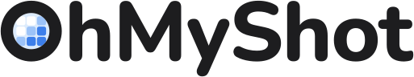

<!-- The wordmark is Tools/logo/make_wordmark.py's output: outlined paths, so it renders on GitHub without fonts.
     The English line under it is also the repository description and OhMyShot's card on the MMFoundation profile
     (MMFoundation/.github, profile/README.md and README.zh-CN.md): change them together. Other pages link to
     #build-and-run, so keep that heading. README.zh-CN.md is the Chinese translation: change it in the same commit. -->

<h1 align="center">
  <picture>
    <source media="(prefers-color-scheme: dark)" srcset="Tools/logo/preview/wordmark-dark.svg">
    
  </picture>
</h1>

<p align="center">
  <b>A native macOS capture tool — screenshots, recordings, annotation, pins, and on-device OCR — built to cost nothing while it waits in the menu bar.</b>
</p>

<p align="center">
  一个原生 macOS 截图工具：截图、录屏、标注、贴图和端侧 OCR，常驻菜单栏时几乎不耗电。
</p>

<p align="center">
  <a href="https://github.com/BenjaminD2023/OhMyShot/releases"></a>
  
  <a href="LICENSE"></a>
</p>

<p align="center">
  <b>English</b>&ensp;|&ensp;<a href="README.zh-CN.md">简体中文</a>
</p>

<p align="center">
  <a href="#why-ohmyshot">Why OhMyShot</a>&ensp;·&ensp;
  <a href="#features">Features</a>&ensp;·&ensp;
  <a href="#power-budget">Power budget</a>&ensp;·&ensp;
  <a href="#getting-started">Getting started</a>&ensp;·&ensp;
  <a href="#contributing">Contributing</a>&ensp;·&ensp;
  <a href="CHANGELOG.md">Changelog</a>
</p>

This is [BenjaminD2023's maintained fork](https://github.com/BenjaminD2023/OhMyShot) of [MMFoundation/OhMyShot](https://github.com/MMFoundation/OhMyShot) (formerly fzlzjerry/OhMyShot). It preserves the local capture, pixel-picker, shortcut, OCR, preview and toolbar improvements, including proposals that were not merged upstream. Updates and packaged builds come from this fork.

Download the Apple silicon build from [Releases](https://github.com/BenjaminD2023/OhMyShot/releases). The DMG contains the app and an Applications shortcut. Fork releases are not Apple-notarized; the fork’s update feed and update archives are signed independently with Sparkle's Ed25519 key. See [release and signing instructions](Docs/releasing.md).

这是独立维护的 fork，保留本地增强功能；安装包和自动更新均来自本 fork。

## Why OhMyShot

<table>
  <tr>
    <td width="50%" valign="top">
      <h3>🪶 Idle means idle</h3>
      In the menu bar it runs no timers, polls nothing, and holds no capture streams or event taps:
      upstream measured <b>0 wakeups</b> and <b>26 MB</b> after launch (not remeasured for this fork; Sparkle adds scheduled update checks). Every number is <a href="#power-budget">measured and published</a>, misses included.
    </td>
    <td width="50%" valign="top">
      <h3>🔤 Text in pixels is data</h3>
      Copy the text from any part of the screen, search your capture history by it (Chinese included), translate it
      in place, and read tables, formulas, and charts with optional on-device model packs.
    </td>
  </tr>
  <tr>
    <td width="50%" valign="top">
      <h3>🔒 Private by default</h3>
      Everything is read on your Mac. There is no OhMyShot server: uploads go only to storage you own, and a cloud OCR
      model runs only with your own API key, when you turn it on.
    </td>
    <td width="50%" valign="top">
      <h3>🍎 Native, free, and open</h3>
      Swift 6, SwiftUI, and AppKit, following macOS conventions down to permissions and VoiceOver. GPL-3.0, with no
      subscription and no paid upgrades.
    </td>
  </tr>
</table>

## Features

| | Feature | What it does |
| :---: | --- | --- |
| 📸 | **Screenshots** | Area, window (with or without its shadow, on a background), full display, the previous area, and a self-timer. Areas can cross displays, and the screen freezes while you choose. All-In-One sets up any of them from one bar. |
| 🗂️ | **Quick Access and Capture History** | A card for each capture to copy, save, mark up, pin, upload, or drag out, and a history you can search by the text in the pictures. |
| ✏️ | **Annotation** | An editor, or drawing straight on the frozen selection: arrows, shapes, text, a highlighter that snaps to text, counters, blur and pixelation (with redaction suggestions from the text it reads), crops, backgrounds, combined images, and project files you can open again. |
| 🔤 | [**Text from pixels**](Docs/ocr.md) | Capture Text copies the text in an area; the Recognized Text window shows it beside the picture with tables, links, and codes, and translates it, also over the original. Optional model packs read Chinese a second time, formulas as LaTeX, and tables and charts. |
| 📌 | [**Pins, color, and measuring**](Docs/measurement-snapping.md) | Always-on-top pictures, text, and colors; a screen color picker and a pixel ruler that snaps to edges. |
| 🎬 | **Recording and Studio** | Screen, window, or area to MP4 or GIF, with system audio, microphone, camera, clicks, and keys. Studio edits a recording afterwards, with automatic zooms that follow the cursor. On macOS 27, with Replay on, the last 15 seconds can be saved at any time. |
| 📜 | **Scrolling capture** | Scroll by hand or let Auto-scroll do it, into one long picture. |
| ☁️ | **Sharing** | Uploads to your own S3-compatible, WebDAV, or custom HTTP storage; printing, email, and the Share menu. |
| ⚙️ | [**Automation**](Docs/automation.md) | CleanShot X–compatible URL commands under `ohmyshot://`, actions in Shortcuts and Spotlight, and a Raycast extension. |
| 🌐 | [**Languages**](Docs/localization.md) | English, Simplified and Traditional Chinese, Japanese, Spanish, and French. |

OhMyShot also appears in other apps' Share menu (to mark up or pin a picture; switch it on in System Settings ›
General › Login Items & Extensions › Sharing) and in Finder's Open With for images.

## Power budget

When no capture is active, the app holds no capture streams or screenshot event taps. Sparkle checks this fork for updates on its standard daily schedule; automatic checks and downloads can be changed in Settings › General. The original capture power targets and upstream measurements (not remeasured for this fork) follow:

| Metric | Target | Measured |
| --- | --- | --- |
| Idle CPU after launch (60 s average) | 0.0% | 0.06–0.09%, from macOS updating the menu bar; no timers of the app's own |
| Idle wakeups | < 1 per second | **0** ✅ |
| Memory after launch | < 30 MB | **26 MB** ✅ |
| Memory after use, idle | < 60 MB | 57 MB after recording ✅; 68 MB after reading formulas and tables ❌ |
| Shortcut → selection overlay | p95 < 50 ms | **p95 9.8 ms** ✅ |
| Shortcut → frozen picture | p95 < 150 ms | **p95 47.7 ms** ✅ |
| Text from a 1000 × 600 px area | < 300 ms | p50 187 ms ✅, p95 370 ms ❌ |
| Recording 1080p at 60 fps | < 15% CPU | 15.7% ❌ |
| App size, without model packs | < 30 MB | 37 MB (14 MB zipped) ❌ |

Model packs run in a helper process that exits when it is done, so they cost the app's own memory nothing. The full
log, with methods, dates, and caveats, is in [Docs/perf.md](Docs/perf.md); measure your own Mac with
`Scripts/power-sample.sh` and `Scripts/latency.sh`.

## Getting started

### Install

Download the DMG from this fork’s [latest release](https://github.com/BenjaminD2023/OhMyShot/releases/latest),
open it, and drag OhMyShot to Applications. Fork releases use Apple Development signing and are not Apple-notarized.
Updates use this fork’s signed feed (Settings › General › Updates); see [the fork release instructions](Docs/releasing.md).

### Requirements

- macOS 26 or later on Apple silicon
- Xcode 27 or later (the app uses the macOS 27 SDK), with its Metal Toolchain (used by the optional VLM pack):
  `xcodebuild -downloadComponent MetalToolchain`
- [XcodeGen](https://github.com/yonaskolb/XcodeGen): `brew install xcodegen`

### Build and run

```sh
git clone https://github.com/BenjaminD2023/OhMyShot.git
cd OhMyShot
Scripts/bootstrap.sh   # generate OhMyShot.xcodeproj from project.yml
Scripts/run.sh         # build the Debug app ("OhMyShot Dev") and launch it
Scripts/test.sh        # run both packages' unit tests (OhMyShotKit, OhMyShotVLM)
```

`build.sh` and `run.sh` regenerate the project when `project.yml` changes. Debug builds use their own bundle
identifier (`….ohmyshot.dev`), URL scheme (`ohmyshot-dev://`), and default shortcuts (⌃⌥⌘ plus a digit), so they
can run next to a release build without fighting over permissions or shortcuts.

### Signing and Screen Recording permission

This fork keeps Hardened Runtime and library validation enabled. Before building, copy `Config/Signing.local.xcconfig.example` to the ignored `Config/Signing.local.xcconfig` and select an existing Apple Development identity for local use, or Developer ID Application for distribution. Use the certificate's actual organizational-unit Team ID. An ad-hoc build is insufficient for loading the separately distributed Sparkle framework with these protections enabled.

macOS ties Screen Recording permission to the app's code signature; a stable signing identity also avoids treating every rebuild as a new app. `Scripts/reset-tcc.sh` clears the Debug build's permissions when needed.

> [!TIP]
> After you grant Screen Recording, relaunch the app: macOS applies the permission only to new processes.
> `Scripts/reset-tcc.sh` clears the Debug build's permissions when you want to start over.

### Updates

Release builds check this fork for signed updates with [Sparkle](https://sparkle-project.org) about once a day (Settings › General › Updates); Debug builds never check. See [Docs/releasing.md](Docs/releasing.md) for packaging and signing. Fork builds use Apple Development signing and are not Apple-notarized.

## Documentation

| Document | What it covers |
| --- | --- |
| [Docs/automation.md](Docs/automation.md) | URL commands, Shortcuts, Spotlight, and the Raycast extension |
| [Docs/ocr.md](Docs/ocr.md) | How text recognition is layered, and its benchmark |
| [Docs/capture-picker.md](Docs/capture-picker.md) | The magnifier at the pointer while you choose an area |
| [Docs/measurement-snapping.md](Docs/measurement-snapping.md) | The pixel ruler's edge snapping |
| [Docs/localization.md](Docs/localization.md) | Adding or improving a translation |
| [Docs/perf.md](Docs/perf.md) | Every performance and power measurement |
| [Docs/releasing.md](Docs/releasing.md) | Packaging, signing, and publishing this fork |
| [PRODUCT.md](PRODUCT.md) and [DESIGN.md](DESIGN.md) | What OhMyShot is for, and how it should look and feel |

## Contributing

Contributions are welcome, whether code, translations, bug reports, or measurements from a Mac other than ours.

- **Report a bug or ask for a feature** in [Issues](https://github.com/MMFoundation/OhMyShot/issues). Include
  your macOS version, your displays, and the steps that lead to the problem.
- **Ask a question or talk with us** on MMFoundation's [Discord](https://mmfoundation.dev/discord).
- **Translate.** You don't need Xcode: [Docs/localization.md](Docs/localization.md) explains how.
- **Send a pull request.** Run `Scripts/test.sh` before you push, and write commit messages as
  [Conventional Commits](https://www.conventionalcommits.org) (`feat(ocr): …`, `fix(studio): …`). Changes that
  could affect idle cost or latency should come with numbers from `Scripts/power-sample.sh` or `Scripts/latency.sh`.
  Read [PRODUCT.md](PRODUCT.md) and [DESIGN.md](DESIGN.md) before larger changes.

### Contributors

<a href="https://github.com/MMFoundation/OhMyShot/graphs/contributors">
  
</a>

## Sponsors

OhMyShot is a project of [MMFoundation](https://mmfoundation.dev/), which takes sponsorship on
[Open Collective](https://opencollective.com/mmfoundation), where every contribution and every expense is
public. Sponsors appear here: a company with its logo and a link, a person with their avatar. Sponsoring
unlocks nothing; OhMyShot is free and complete for everyone.

<!-- MMFoundation's sponsors, drawn by Open Collective and kept current there (its images are
     cached for up to a day): each company's logo links to its website, and people's avatars to the
     Collective. While no company sponsors, the first logo slot is Open Collective's Contribute button.
     The slots run from the middle out (8 6 4 2 0 1 3 5 7 9), so the first sponsor stands in the
     middle and the row stays centred while slots are empty.
     The same block is in WallpaperMachine's README. -->
<p align="center">
  <a href="https://opencollective.com/mmfoundation/organization/8/website"></a>
  <a href="https://opencollective.com/mmfoundation/organization/6/website"></a>
  <a href="https://opencollective.com/mmfoundation/organization/4/website"></a>
  <a href="https://opencollective.com/mmfoundation/organization/2/website"></a>
  <a href="https://opencollective.com/mmfoundation/organization/0/website"></a>
  <a href="https://opencollective.com/mmfoundation/organization/1/website"></a>
  <a href="https://opencollective.com/mmfoundation/organization/3/website"></a>
  <a href="https://opencollective.com/mmfoundation/organization/5/website"></a>
  <a href="https://opencollective.com/mmfoundation/organization/7/website"></a>
  <a href="https://opencollective.com/mmfoundation/organization/9/website"></a>
</p>
<p align="center">
  <a href="https://opencollective.com/mmfoundation"></a>
</p>

## Acknowledgments

OhMyShot is built with [Sparkle](https://sparkle-project.org),
[KeyboardShortcuts](https://github.com/sindresorhus/KeyboardShortcuts),
[MLX Swift](https://github.com/ml-explore/mlx-swift), and
[Swift Numerics](https://github.com/apple/swift-numerics). Their notices are in
[App/Acknowledgments.md](App/Acknowledgments.md).

## License

OhMyShot is free software, licensed under the [GNU General Public License v3.0](LICENSE).
Copyright © 2026 OhMyShot contributors.

OhMyShot is a project of [MMFoundation](https://mmfoundation.dev/).
