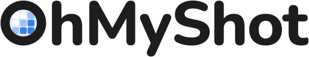

<!-- The Chinese translation of README.md. Change both in the same commit; README.md is authoritative.
     Feature names follow the app's own zh-Hans strings (快速访问, 截图历史, 贴图, 截取文字, 多合一…). -->

<h1 align="center">
  <picture>
    <source media="(prefers-color-scheme: dark)" srcset="Tools/logo/preview/wordmark-dark.svg">
    
  </picture>
</h1>

<p align="center">
  <b>一个原生 macOS 截图工具：截图、录屏、标注、贴图和端侧 OCR，常驻菜单栏时几乎不耗电。</b>
</p>

<p align="center">
  <a href="https://github.com/MMFoundation/OhMyShot/releases/latest"></a>
  
  
  <a href="LICENSE"></a>
  <a href="#contributing"></a>
</p>

<p align="center">
  <a href="README.md">English</a>&ensp;|&ensp;<b>简体中文</b>
</p>

<p align="center">
  <a href="#why-ohmyshot">为什么选择 OhMyShot</a>&ensp;·&ensp;
  <a href="#features">功能</a>&ensp;·&ensp;
  <a href="#power-budget">功耗预算</a>&ensp;·&ensp;
  <a href="#getting-started">快速开始</a>&ensp;·&ensp;
  <a href="#contributing">参与贡献</a>&ensp;·&ensp;
  <a href="CHANGELOG.md">更新日志</a>
</p>

<!-- 有了截图或动图之后放在这里：
<p align="center">
  
</p>
-->

> [!NOTE]
> **刚刚起步。** 0.1.0 是第一个版本。OhMyShot 在 macOS 27 beta、Apple 芯片的 Mac 上开发和测试（一台 6K 带鱼屏外接显示器加内建 XDR 屏幕）。
> 它可以为 macOS 26 构建，但尚未在 macOS 26 上实际运行过。
>
> 本文是 [README.md](README.md) 的中文翻译，两者不一致时以英文版为准。

<a id="why-ohmyshot"></a>

## 为什么选择 OhMyShot

<table>
  <tr>
    <td width="50%" valign="top">
      <h3>🪶 闲置就是真的闲置</h3>
      待在菜单栏时，不跑定时器、不轮询，也不占用任何截屏流或事件监听：启动后<b>唤醒次数为 0</b>，内存仅 <b>26 MB</b>。
      每一项数据都经过<a href="#power-budget">实测并公开</a>，没达标的也照实列出。
    </td>
    <td width="50%" valign="top">
      <h3>🔤 图里的文字也是数据</h3>
      屏幕上任何区域的文字都能直接复制；截图历史可以按图中文字搜索（支持中文）；可以原地翻译；
      装上可选的端侧模型包，还能识别表格、公式和图表。
    </td>
  </tr>
  <tr>
    <td width="50%" valign="top">
      <h3>🔒 默认保护隐私</h3>
      所有识别都在本机完成。OhMyShot 没有自己的服务器：上传只会传到你自己的存储；云端 OCR 模型只有在你填入自己的
      API Key 并主动开启后才会使用。
    </td>
    <td width="50%" valign="top">
      <h3>🍎 原生、免费、开源</h3>
      基于 Swift 6、SwiftUI 和 AppKit，从权限申请到 VoiceOver 都遵循 macOS 的规范。以 GPL-3.0 开源，
      没有订阅，也没有付费升级。
    </td>
  </tr>
</table>

<a id="features"></a>

## 功能

| | 功能 | 说明 |
| :---: | --- | --- |
| 📸 | **截图** | 区域、窗口（可带或不带阴影，可加背景）、全屏、上次区域，以及定时截图。区域可以跨显示器，选择时屏幕会冻结。「多合一」在一条工具栏里完成以上所有设置。 |
| 🗂️ | **快速访问与截图历史** | 每次截图都会出现一张卡片，可以复制、保存、标注、贴图、上传或直接拖出；截图历史可以按图中文字搜索。 |
| ✏️ | **标注** | 在编辑器里标注，或直接在冻结的选区上绘制：箭头、形状、文字、自动对齐文字的荧光笔、步骤编号、模糊和像素化（会根据识别出的文字给出打码建议）、裁剪、背景、拼图，以及可再次打开的项目文件。 |
| 🔤 | [**文字识别**](Docs/ocr.md) | 「截取文字」复制区域内的文字；「识别的文字」窗口把文字和原图并排显示，能识别表格、链接、条码和二维码，并可翻译，译文也可以直接覆盖在原图上。可选模型包能对中文做二次识别，把公式转成 LaTeX，并读取表格和图表。 |
| 📌 | [**贴图、取色与测量**](Docs/measurement-snapping.md) | 把图片、文字和颜色置顶贴在屏幕上；屏幕取色器，以及能自动吸附边缘的像素标尺。 |
| 🎬 | **录屏与 Studio** | 录制屏幕、窗口或区域，导出 MP4 或 GIF，可录系统声音、麦克风、摄像头，并显示点击和按键。Studio 用于录制后的剪辑，能自动跟随光标缩放。在 macOS 27 上开启 Replay 后，随时可以保存最近 15 秒。 |
| 📜 | **滚动截图** | 手动滚动或交给「自动滚动」，拼成一张长图。 |
| ☁️ | **分享** | 上传到你自己的 S3 兼容存储、WebDAV 或自定义 HTTP 接口；也支持打印、邮件和系统分享菜单。 |
| ⚙️ | [**自动化**](Docs/automation.md) | 兼容 CleanShot X 的 URL 命令（`ohmyshot://`），支持快捷指令和聚焦搜索，并提供 Raycast 扩展。 |
| 🌐 | [**多语言**](Docs/localization.md) | 英文、简体中文、繁体中文、日文、西班牙文和法文。 |

OhMyShot 还会出现在其他 App 的分享菜单中（用来标注或贴图；在「系统设置 › 通用 › 登录项与扩展 › 共享」中开启），
以及访达中图片的「打开方式」里。

<a id="power-budget"></a>

## 功耗预算

每个里程碑都以实测数据为准。以下是最新结果，测于上文那台 Mac，均为 Debug 构建：

| 指标 | 目标 | 实测 |
| --- | --- | --- |
| 启动后闲置 CPU（60 秒平均） | 0.0% | 0.06–0.09%，来自 macOS 刷新菜单栏；App 自身没有任何定时器 |
| 闲置唤醒次数 | 每秒 < 1 次 | **0** ✅ |
| 启动后内存 | < 30 MB | **26 MB** ✅ |
| 使用后闲置内存 | < 60 MB | 录屏后 57 MB ✅；识别公式和表格后 68 MB ❌ |
| 快捷键 → 显示选区界面 | p95 < 50 ms | **p95 9.8 ms** ✅ |
| 快捷键 → 冻结画面 | p95 < 150 ms | **p95 47.7 ms** ✅ |
| 识别约 1000 × 600 px 区域的文字 | < 300 ms | p50 187 ms ✅，p95 370 ms ❌ |
| 录制 1080p 60 fps | CPU < 15% | 15.7% ❌ |
| App 体积（不含模型包） | < 30 MB | 37 MB（压缩后 14 MB）❌ |

模型包在独立的辅助进程中运行，用完即退出，不占用 App 自身的内存。完整记录（含测量方法、日期和注意事项）见
[Docs/perf.md](Docs/perf.md)；也可以用 `Scripts/power-sample.sh` 和 `Scripts/latency.sh` 在自己的 Mac 上测量。

<a id="getting-started"></a>

## 快速开始

### 安装

从[最新版本](https://github.com/MMFoundation/OhMyShot/releases/latest)下载 `OhMyShot-<版本号>.zip`，解压后把 OhMyShot
移到「应用程序」文件夹。发布的版本都用 Developer ID 签名并经过 Apple 公证，之后会自动更新（「设置 › 通用 › 更新」）。

### 环境要求

- macOS 26 或更高版本，Apple 芯片
- Xcode 27 或更高版本（应用用 macOS 27 SDK 构建），并安装 Metal Toolchain（VLM 模型包使用的 MLX 需要编译 Metal 内核）：
  `xcodebuild -downloadComponent MetalToolchain`
- [XcodeGen](https://github.com/yonaskolb/XcodeGen)：`brew install xcodegen`

<a id="build-and-run"></a>

### 构建与运行

```sh
git clone https://github.com/MMFoundation/OhMyShot.git
cd OhMyShot
Scripts/bootstrap.sh   # 根据 project.yml 生成 OhMyShot.xcodeproj
Scripts/run.sh         # 构建 Debug 版（"OhMyShot Dev"）并启动
Scripts/test.sh        # 运行两个包的单元测试（OhMyShotKit、OhMyShotVLM）
```

`project.yml` 有改动时，`build.sh` 和 `run.sh` 会自动重新生成项目。Debug 版使用独立的 Bundle ID（`….ohmyshot.dev`）、
URL scheme（`ohmyshot-dev://`）和默认快捷键（⌃⌥⌘ 加数字），可以和正式版同时运行，权限和快捷键互不冲突。

### 签名与屏幕录制权限

macOS 把屏幕录制权限绑定在 App 的代码签名上。使用 ad-hoc 签名时，每次重新构建都会被当成一个新 App，权限随之丢失。
要保留权限，请把 `Config/Signing.local.xcconfig.example` 复制为 `Config/Signing.local.xcconfig`，并填入你的 Apple
Development 团队（免费的个人团队即可）。

> [!TIP]
> 授予屏幕录制权限后，请重新启动 App：macOS 只会把权限应用到新启动的进程。
> 想从头再来时，`Scripts/reset-tcc.sh` 可以清除 Debug 版的权限。

### 更新

正式版通过 [Sparkle](https://sparkle-project.org) 大约每天检查一次更新（「设置 › 通用 › 更新」），读取附在本仓库
GitHub Releases 上的签名 appcast；Debug 版从不检查更新。发布、签名和公证的流程见 [Docs/release.md](Docs/release.md)。

## 文档

以下文档均为英文。

| 文档 | 内容 |
| --- | --- |
| [Docs/automation.md](Docs/automation.md) | URL 命令、快捷指令、聚焦搜索和 Raycast 扩展 |
| [Docs/ocr.md](Docs/ocr.md) | 文字识别的分层设计与基准测试 |
| [Docs/capture-picker.md](Docs/capture-picker.md) | 选择区域时光标处的放大镜 |
| [Docs/measurement-snapping.md](Docs/measurement-snapping.md) | 像素标尺的边缘吸附 |
| [Docs/localization.md](Docs/localization.md) | 新增或改进翻译 |
| [Docs/perf.md](Docs/perf.md) | 全部性能与功耗测量记录 |
| [Docs/release.md](Docs/release.md) | 构建、签名和公证正式版 |
| [PRODUCT.md](PRODUCT.md) 与 [DESIGN.md](DESIGN.md) | OhMyShot 的定位，以及它的外观与交互设计 |

<a id="contributing"></a>

## 参与贡献

欢迎任何形式的贡献：代码、翻译、Bug 反馈，或者在你的 Mac 上测得的性能数据。

- **反馈 Bug 或提出功能建议**：请到 [Issues](https://github.com/MMFoundation/OhMyShot/issues)，中文或英文均可。
  请写明 macOS 版本、显示器配置和复现步骤。
- **提问或交流**：请到 MMFoundation 的 [Discord](https://mmfoundation.dev/discord)。
- **参与翻译**：不需要 Xcode，详见 [Docs/localization.md](Docs/localization.md)。
- **提交 Pull Request**：推送前请运行 `Scripts/test.sh`，提交信息遵循
  [Conventional Commits](https://www.conventionalcommits.org/zh-hans/)（如 `feat(ocr): …`、`fix(studio): …`）。
  可能影响闲置功耗或响应速度的改动，请附上 `Scripts/power-sample.sh` 或 `Scripts/latency.sh` 的测量结果。
  较大的改动请先阅读 [PRODUCT.md](PRODUCT.md) 和 [DESIGN.md](DESIGN.md)。

### 贡献者

<a href="https://github.com/MMFoundation/OhMyShot/graphs/contributors">
  
</a>

<a id="sponsors"></a>

## 赞助者

OhMyShot 是 [MMFoundation](https://mmfoundation.dev/zh/) 的项目。MMFoundation 在
[Open Collective](https://opencollective.com/mmfoundation) 上接受赞助，每一笔赞助和每一笔开销都在那里公开。
赞助者会出现在这里：公司展示标志和链接，个人展示头像。赞助不会解锁任何功能，OhMyShot 对每个人都免费且完整。

<!-- MMFoundation's sponsors, drawn by Open Collective and kept current there (its images are
     cached for up to a day): each company's logo links to its website, and people's avatars to the
     Collective. While no company sponsors, the first logo slot is Open Collective's Contribute button.
     The slots run from the middle out (8 6 4 2 0 1 3 5 7 9), so the first sponsor stands in the
     middle and the row stays centred while slots are empty.
     The same block is in WallpaperMachine's README. -->
<p align="center">
  <a href="https://opencollective.com/mmfoundation/organization/8/website"></a>
  <a href="https://opencollective.com/mmfoundation/organization/6/website"></a>
  <a href="https://opencollective.com/mmfoundation/organization/4/website"></a>
  <a href="https://opencollective.com/mmfoundation/organization/2/website"></a>
  <a href="https://opencollective.com/mmfoundation/organization/0/website"></a>
  <a href="https://opencollective.com/mmfoundation/organization/1/website"></a>
  <a href="https://opencollective.com/mmfoundation/organization/3/website"></a>
  <a href="https://opencollective.com/mmfoundation/organization/5/website"></a>
  <a href="https://opencollective.com/mmfoundation/organization/7/website"></a>
  <a href="https://opencollective.com/mmfoundation/organization/9/website"></a>
</p>
<p align="center">
  <a href="https://opencollective.com/mmfoundation"></a>
</p>

## 致谢

OhMyShot 使用了 [Sparkle](https://sparkle-project.org)、
[KeyboardShortcuts](https://github.com/sindresorhus/KeyboardShortcuts)、
[MLX Swift](https://github.com/ml-explore/mlx-swift) 和
[Swift Numerics](https://github.com/apple/swift-numerics)。它们的许可声明见
[App/Acknowledgments.md](App/Acknowledgments.md)。

## 许可证

OhMyShot 是自由软件，以 [GNU 通用公共许可证 第 3 版](LICENSE)发布。
Copyright © 2026 OhMyShot contributors.

OhMyShot 是 [MMFoundation](https://mmfoundation.dev/zh/) 的项目。
